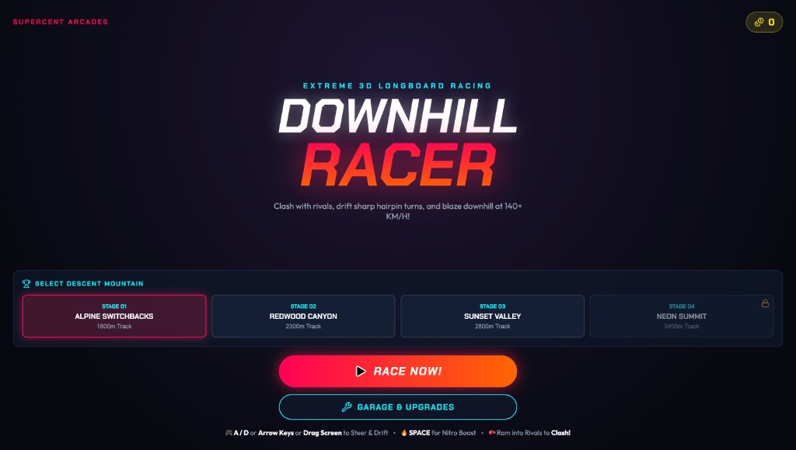
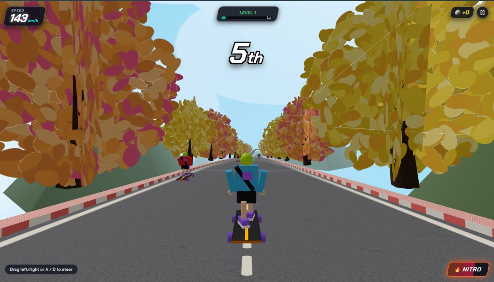
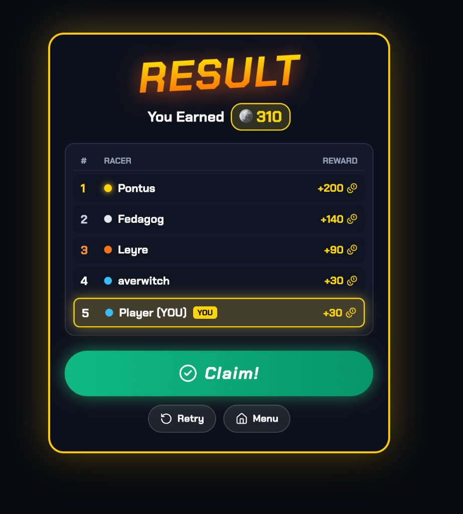

# Multimedia Systems Lab — Lab Test 2
## Project: Downhill Racer — Customizable Arcade Game

**Author:** Abhishek Yaduwanshi  
**Course:** Multimedia Systems Lab (Lab Test 2)  
**Repository:** [https://github.com/Abhishek4852/downhill-racer-MM-Lab-Test-2.git](https://github.com/Abhishek4852/downhill-racer-MM-Lab-Test-2.git)  

---

## 📖 Executive Summary & Game Overview

**Downhill Racer** is a high-speed arcade racing game developed for **Multimedia Systems Lab — Lab Test 2**. In this game, the player controls a customized longboard racer speeding down steep mountain switchbacks at speeds exceeding 140 km/h. 

The application demonstrates core multimedia engineering concepts:
- **Computer Animation & 3D/2.5D Rendering:** Real-time procedural rendering via Three.js and HTML5 Canvas.
- **Audio Synthesis:** A zero-dependency procedural audio engine built on the browser **Web Audio API** (wind noise, wheel rumble, drift tire screech, nitro ignition, clash impact).
- **Interactive Event Handling:** Responsive keyboard inputs and smooth mouse/touch drag steering.
- **State Management & Collision Detection:** Multi-state game cycle (Start Menu, Active Gameplay, Garage Upgrades, Results Screen) with bounding-box collision detection for vehicles, obstacles, and AI rivals.

---

## 📸 Game Interface & Screenshots

The game features three primary views designed with a modern arcade HUD aesthetic:

### 1. Start Screen / Main Menu View
The title screen allows players to select mountain tracks, inspect their coin balance, access the board upgrade garage, and review control tutorials before initiating the race.



*Key Components:*
- **Stage Selector:** Alpine Switchbacks (1800m), Redwood Canyon (2300m), Sunset Valley (2800m), Neon Summit (3400m).
- **Interactive Action Buttons:** Direct "RACE NOW!" launch and "GARAGE & UPGRADES" modal.
- **Persistent Header:** Accumulated coin counter stored via LocalStorage.

---

### 2. Active Gameplay Screen View
During active descent, the player navigates dynamically curved roads, overtakes AI rivals, dodges oncoming traffic, and collects speed boosters.



*Key Components:*
- **Dynamic Speedometer:** Displays instantaneous velocity up to 160 km/h with visual nitro flame alerts.
- **Race Position Indicator:** Real-time leaderboard rank (e.g., 5th place) updated dynamically based on track Z-depth.
- **Track Progress Bar:** Interactive descent bar displaying completion percentage towards the finish line.
- **Steering & Nitro Controls:** Dynamic on-screen nitro trigger with level-refill progress.

---

### 3. Result / Game-Over Screen View
Upon crossing the finish line (or stage completion), the result screen displays race standing, coin earnings, and instant restart/menu options.



*Key Components:*
- **Podium Breakdown:** Final finish position comparing the player against AI rivals (*Pontus, Fedagog, Leyre, averwitch*).
- **Reward Calculation:** Detailed breakdown of earned coins from placements and clash bonuses.
- **Seamless State Transition:** "Retry" (instant restart without page reload) and "Menu" navigation buttons.

---

## 🎮 Player Controls

The game supports both desktop keyboard navigation and mobile/touch drag inputs:

| Control Action | Primary Key | Secondary Key | Touch / Mouse |
| :--- | :--- | :--- | :--- |
| **Steer Left** | `A` | `←` (Left Arrow) | Drag Left on screen |
| **Steer Right** | `D` | `→` (Right Arrow) | Drag Right on screen |
| **Drift Carve** | Hold Left/Right (> 0.65 steer) | Hold Left/Right | Drag hard toward screen edges |
| **Nitro Boost** | `Spacebar` | `Shift` | Tap **NITRO** on-screen HUD button |
| **Rival Clash** | Steer into adjacent rival | Ram rival at high speed | Steer into rival contact radius |

---

## 🏆 Game Rules, Scoring & Mechanics

1. **Objective:** Complete the downhill track in the shortest time possible while competing for 1st place against AI competitors.
2. **Scoring & Coin Rewards:**
   - **Podium Finish Rewards:**
     - 1st Place: `+200 Coins`
     - 2nd Place: `+140 Coins`
     - 3rd Place: `+90 Coins`
     - 4th Place: `+30 Coins`
     - 5th Place: `+30 Coins`
   - **Track Pickups:** Gold coins scattered along the course grant `+10 Coins` each.
   - **Rival Knockouts:** Ramming an AI rival at speed or during a drift awards `+50 Coins` bonus.
   - **Near Miss Combos:** Passing within close proximity of traffic vehicles awards `+10 Coins` combo points.
3. **Hazards & Penalties:**
   - **Civilian Vehicles (Red Sports Cars & Blue Utility Trucks):** Crashing into traffic reduces velocity significantly and resets momentum.
   - **Traffic Cones:** Minor collision slowdown.
   - **Roadside Curbs:** Clamps racer position within the asphalt boundary to prevent falling off the mountain.
4. **Boost & Drift Mechanics:**
   - **Boost Pads:** Speed pads placed along the road propel the racer with instant acceleration.
   - **Nitro Tank:** Passively recharges over time; consuming 25% gauge triggers a 3-second nitro thrust up to 160 km/h with screen FOV warping.
   - **Drifting:** Sharp carving reduces top speed slightly in exchange for tighter turning and slide-glove sparks.
5. **Restart Option:** The player can immediately retry the level or select another stage from the result screen without refreshing the browser.

---

## 🎨 Individual Customization Features

As required by the lab test specification, this game implements individual customizations:

1. **Custom Character & Longboard 3D Sprite Model:**
   - Built with a unique visual theme: **Sky-blue puffer jacket**, **cross-body satchel strap**, **lime-green spiky hair/beanie**, **purple skate sneakers with white soles**, and **black shorts with purple racing stripes**.
   - Custom **Maple Wood Longboard** deck with dark grip tape, yellow center alignment stripe, heavy-duty aluminum trucks, and purple urethane downhill wheels.
2. **Procedural Slide-Glove & Sparks Drift Animation:**
   - When entering a sharp drift, the skater drops into a low tuck pose, lowers their slide glove to the asphalt, and dynamic particle sparks emit from the puck based on turn direction.
3. **Multi-Phase Dynamic Highway Track:**
   - The 1800m course dynamically shifts across 5 visual sections:
     - **0m – 350m:** Autumn Forest Highway (golden/orange foliage with falling leaf particles).
     - **350m – 650m:** Graffiti Underpass Tunnel (concrete arch with urban textures).
     - **650m – 1100m:** Open Downhill Valley (alpine mountain vistas and wildflower fields).
     - **1100m – 1400m:** Futuristic Glass Ring Tubular Structure.
     - **1400m – 1800m:** Off-Road Mountain Dirt Track leading to the finish banner.
4. **Garage Upgrade System:**
   - Players spend earned coins in the **Garage & Upgrades** modal to permanently enhance:
     - **Top Speed:** Increases base cruising speed.
     - **Handling & Drift:** Sharper turn response and higher drift stability.
     - **Nitro Efficiency:** Faster nitro tank recharge rate.
     - **Shield Armor:** Mitigates impact speed reduction during collisions.

---

## 🔊 Multimedia Integration

### 1. Procedural Audio Engine (`RacerAudio.ts`)
Rather than relying on static external audio files, the game utilizes the browser **Web Audio API** to generate all game sound effects procedurally:
- **Dynamic Wind Noise:** Generated using a white noise buffer routed through a low-pass `BiquadFilterNode` whose cutoff frequency scales continuously with racer velocity ($0 - 160\text{ km/h}$).
- **Road Vibration & Wheel Rumble:** A low-frequency sawtooth oscillator ($45\text{ Hz}$) that modulates amplitude with road ground contact and cuts off during jumps.
- **Drift Screech:** Band-passed noise oscillator with resonance that plays when lateral carving exceeds drift thresholds.
- **Nitro Boost Woosh:** Dual-oscillator pitch sweep ($120\text{ Hz} \to 480\text{ Hz}$) with high gain envelope.
- **Clash & Impact:** Low punch oscillator ($180\text{ Hz} \to 40\text{ Hz}$) with rapid decay.
- **Coin Chime:** Two-tone arpeggio sine waves ($880\text{ Hz}$ and $1320\text{ Hz}$).

### 2. Procedural Canvas Textures (`TextureGenerator.ts`)
Road surfaces, red/white corner curbs, chevron directional signs, graffiti walls, and autumn foliage are synthesized in real-time onto HTML5 Canvas elements and converted into Three.js textures.

---

## 🧮 Algorithm & Collision Detection Logic

### 1. Procedural Road Geometry & Descent Math
The mountain road center line $X(z)$ and height $Y(z)$ are calculated via continuous trigonometric functions:

$$\text{RoadCenter}(z) = \sin(0.009 \cdot z) \cdot 8 \cdot C_f + \cos(0.0035 \cdot z) \cdot 14 \cdot C_f$$

$$\text{RoadHeight}(z) = -0.11 \cdot z + 3.5 \cdot \sin(0.012 \cdot z)$$

Where:
- $z$ represents distance traveled down the track.
- $C_f$ is the mountain curve factor ($1.0$ to $1.35$ depending on stage difficulty).
- The tangent heading angle $\theta_{\text{heading}} = \text{atan2}(X_{z+2} - X_z, 2)$ aligns the skater model and camera to the curvature of the road.

### 2. Axis-Aligned Bounding Box (AABB) Collision Detection
Collisions are evaluated every frame ($60\text{ FPS}$) in track coordinates:

```typescript
// Traffic vehicle collision test
const pz = this.playerZ;
const playerGlobalX = this.world.getRoadCenter(pz) + this.playerX;

for (const car of this.world.trafficVehicles) {
  const carGlobalX = this.world.getRoadCenter(car.z) + car.x;
  const dx = Math.abs(playerGlobalX - carGlobalX);
  const dz = Math.abs(pz - car.z);

  // Direct vehicle crash
  if (dz < 3.8 && dx < 2.0) {
    this.speed = Math.max(25, this.speed * 0.4);
    racerAudio.playClash();
    this.showCombo('CRASH! 💥');
  } 
  // Near-miss mechanic (video recreation)
  else if (dz < 7.0 && dx < 3.2 && !car.hasNearMissed) {
    car.hasNearMissed = true;
    this.coinsCollected += 10;
    RacerStorage.addCoins(10);
    this.showCombo('NEAR MISS! +10 ⚡');
    racerAudio.playCoin();
  }
}
```

### 3. AI Rival Competitor Behavior
Each rival maintains independent forward velocity, lane offset, and randomized sinusoidal steering:

$$X_{\text{rival}}(t) = X_{\text{base}} + \sin(0.05 \cdot z + \text{speed}) \cdot 2.5$$

When the player collides with an AI competitor:
$$\text{Distance}_Z < 2.2\text{ m} \quad \text{and} \quad \text{Distance}_X < 1.4\text{ m}$$
The rival enters a knocked-out spin state, drops their speed to $10\text{ km/h}$, and the player earns a **Knockout Clash +50** bonus.

---

## 📁 Project Structure

```
downhill-racer/
├── screenshots/                  # Documentation screenshots
│   ├── start-screen.jpg          # Main menu / track selector
│   ├── gameplay-screen.jpg       # Active downhill racing view
│   └── result-screen.jpg         # Results & rewards leaderboard
├── src/
│   ├── audio/
│   │   └── RacerAudio.ts         # Web Audio API procedural sound engine
│   ├── components/
│   │   ├── DownhillHUD.tsx       # Live racing heads-up display
│   │   ├── GarageModal.tsx       # Upgrades shop modal
│   │   ├── MainMenu.tsx          # Start screen & track selection
│   │   ├── ThreeCanvas.tsx       # Three.js viewport & event listener bindings
│   │   └── VictoryModal.tsx      # Results podium & restart triggers
│   ├── game/
│   │   ├── DownhillWorld.ts      # Road geometry, scenery, traffic, curbs
│   │   ├── GameEngine.ts         # Physics loop, steering, collision, scoring
│   │   ├── LevelData.ts          # Mountain track stages configuration
│   │   ├── SkaterMesh.ts         # 3D Skater model, leaning, sparks, wheels
│   │   └── TextureGenerator.ts   # Procedural canvas textures
│   ├── storage/
│   │   └── RacerStorage.ts       # LocalStorage coin & upgrade state
│   ├── types/
│   │   └── game.ts               # TypeScript data interfaces
│   ├── App.tsx                   # Top-level state orchestrator
│   ├── main.tsx                  # React DOM mount point
│   └── App.css                   # Responsive arcade UI styling
├── .gitignore                    # Git ignore file (node_modules, dist, etc.)
├── package.json                  # Dependencies & build scripts
├── tsconfig.json                 # TypeScript compiler configuration
└── vite.config.ts                # Vite bundler configuration
```

---

## 🚀 Execution & Setup Instructions

### Prerequisites
- **Node.js** (v18.0.0 or higher recommended)
- **npm** (bundled with Node.js)

### 1. Clone the Repository
```bash
git clone https://github.com/Abhishek4852/downhill-racer-MM-Lab-Test-2.git
cd downhill-racer-MM-Lab-Test-2
```

### 2. Install Dependencies
```bash
npm install
```

### 3. Launch Development Server
```bash
npm run dev
```
Open your browser and navigate to the displayed local address (typically `http://localhost:5173/`).

### 4. Build for Production
```bash
npm run build
```
The optimized production bundle will be generated in the `dist/` directory.

---

## 🎯 Verification of Lab Requirements

| Lab Test Requirement | Implementation in Downhill Racer |
| :--- | :--- |
| **Game Interface** | Complete Start Menu, Active HUD (Speedometer, Rank, Progress, Nitro), and Result Screen. |
| **Player Controls** | Arrow Keys / `A` / `D` keys, Spacebar Nitro, and mouse/touch drag navigation. |
| **Animation** | 60 FPS continuous Three.js physics loop, wheel rotation, body carve tilt, and particle sparks. |
| **Collision Detection** | Bounding box checks for civilian cars, cargo trucks, traffic cones, collectible coins, and AI rivals. |
| **Scoring** | Coin pickups (+10), Near Miss combos (+10), Rival knockouts (+50), and podium placement prizes. |
| **Difficulty Progression** | 4 unlocked mountain stages with increasing curve factors, steeper descents, and faster rivals. |
| **Game States** | Managed states: `menu`, `playing`, `victory` (results), and `garage` modal. |
| **Multimedia Integration** | Real-time procedural textures, 3D character mesh, and Web Audio API synthesized sound effects. |
| **Customization** | Custom character outfit, downhill longboard design, multi-phase tracks, and Garage upgrade economy. |
| **Restart Option** | Instant "Retry" option without needing to refresh or restart the browser. |

---

*Submitted for Multimedia Systems Lab Test 2 Evaluation.*
